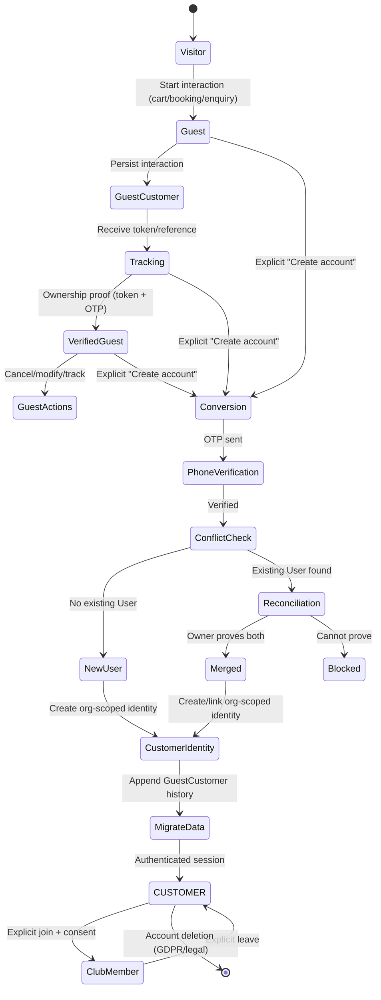

# Guest-to-CUSTOMER Lifecycle

**Status:** `OWNER_APPROVED` (architectural principle)

**Date:** 2026-11-20

**Related:** `docs/architecture/ADR-GUEST-FIRST-IDENTITY-OPTIONAL.md`, `docs/identity/GUEST-FIRST-ACCESS-MATRIX.md`, `plans/guest-first-implementation-plan.md`

---

## Purpose

This document defines the complete lifecycle of a guest interaction and the optional, explicit, secure, idempotent, and non-destructive path to becoming a registered `CUSTOMER`. It captures the distinction between `Visitor`, `Guest`, `GuestCustomer`, `CustomerIdentity`, and `CUSTOMER` as defined in the Guest-first ADR.

---

## Conceptual Model

```
Visitor (unauthenticated browser actor)
    │
    ▼ [starts interaction: cart, booking, enquiry]
Guest (interaction state without registered account)
    │
    ├──▶ Persists as GuestCustomer (cart, order, appointment, hotel enquiry)
    │         │
    │         ├──▶ Receives tracking token / booking reference
    │         ├──▶ Can view status via token + ownership verification
    │         ├──▶ Can cancel/modify via verified ownership
    │         └──▶ Receives transactional SMS via verified phone at interaction
    │
    └──▶ [OPTIONAL] Explicit Guest-to-CUSTOMER conversion
              │
              ▼
         CUSTOMER (authenticated User with role: "CUSTOMER")
              │
              ├──▶ CustomerIdentity per organization (interaction history)
              ├──▶ CustomerClubMembership per organization (opt-in, audited)
              └──▶ Full history, profile, addresses, loyalty, club
```

---

## State Definitions

| State | Description | Persistence | Auth Required |
|-------|-------------|-------------|---------------|
| **Visitor** | Unauthenticated browser actor, no server-side identity | Session cookie only | No |
| **Guest** | Interaction state (cart, booking, enquiry) without account | `GuestCustomer` record + session | No |
| **GuestCustomer** | Persisted data entity supporting guest interactions | Database (`GuestCustomer` model) | No |
| **CUSTOMER** | Registered `User` with `role: "CUSTOMER"` | Database (`User` model) | Yes (session) |
| **CustomerIdentity** | Organization-scoped customer relationship & history | Database (`CustomerIdentity` model) | Yes (org-scoped) |
| **CustomerClubMembership** | Explicit per-tenant loyalty membership | Database (`CustomerClubMembership` model) | Yes (org-scoped) |

---

## Lifecycle Stages

### Stage 1: Visitor Arrival

**Trigger:** Visitor lands on any public page (shop, appointment, hotel, platform)

**Capabilities:**
- Full public browsing (products, services, rooms, content)
- No ownership proof required
- No session persistence required beyond analytics cookie

**Data:** None persisted

---

### Stage 2: Guest Interaction Initiation

**Trigger:** Visitor performs a stateful action:
- Adds item to cart (SHOP)
- Books appointment (APPOINTMENT)
- Submits hotel stay enquiry (HOTEL)
- Proceeds to guest checkout (SHOP)

**Creates:** `GuestCustomer` record linked to session cookie

**Capabilities by Tenant Type:**

| Tenant | Guest Action | Persisted As | Tracking Token |
|--------|--------------|--------------|----------------|
| SHOP | Add to cart | `GuestCart` → `GuestCustomer` | Session cookie |
| SHOP | Guest checkout | `GuestCustomer` + `Order` | Order number + phone token |
| APPOINTMENT | Book appointment | `GuestCustomer` + `Appointment` | Booking reference |
| HOTEL | Submit enquiry | `GuestCustomer` + `HotelGuestBookingRequest` | Private tracking token |

**Invariants:**
- No authentication required
- No `User` record created
- Phone/email collected only for transactional fulfillment (OTP, SMS)
- Phone verification at interaction ≠ account creation (ADR invariant #11)

---

### Stage 3: Guest Post-Interaction Tracking

**Trigger:** Guest completes interaction and receives tracking token/reference

**Capabilities:**
- View status via token/reference + ownership verification
- Cancel/modify via verified ownership (phone/OTP + token)
- Receive transactional SMS (order confirmation, appointment reminder, enquiry response)

**Ownership Verification Methods:**
| Interaction | Verification Required |
|-------------|----------------------|
| Order tracking | Order number + phone (or token) |
| Order cancel/modify | Order token + phone OTP |
| Appointment lookup | Booking reference OR phone (P0-A: restrict phone-only) |
| Appointment cancel/reschedule | Booking reference + phone OTP |
| Hotel enquiry tracking | Private tracking token |

**Invariants:**
- Guest never sees other guests' data
- Cross-tenant access impossible (tenant-scoped tokens)
- Phone-only lookup restricted where it exposes PII (P0-A)

---

### Stage 4: Optional Guest-to-CUSTOMER Conversion

**Trigger:** Guest explicitly chooses to create an account (never automatic)

**Entry Points:**
- "Create account" after guest checkout
- "Save my appointments" after booking
- "Track all my enquiries" after hotel enquiry
- Direct registration via `/register` or phone OTP login

**Process (Secure, Idempotent, Non-Destructive):**

```
1. Guest initiates conversion (explicit action)
       │
       ▼
2. Phone/email verification (OTP) — proves ownership of contact
       │
       ▼
3. Check for existing User with same verified phone/email
       │
       ├──▶ No existing User → Create new User (role: CUSTOMER)
       │
       └──▶ Existing User found → CONFLICT QUARANTINE
                │
                ├──▶ If User has no CustomerIdentity in this org → Link GuestCustomer → User
                │
                └──▶ If User has CustomerIdentity in this org → RECONCILIATION_REQUIRED
                        │
                        ├──▶ Owner proves ownership of BOTH → Merge (non-destructive)
                        │
                        └──▶ Cannot prove → Block, require manual resolution
       │
       ▼
4. Create CustomerIdentity for this organization (linked to User)
       │
       ▼
5. Migrate GuestCustomer data → CustomerIdentity.interactions (append-only)
       │
       ▼
6. Session established as authenticated CUSTOMER
       │
       ▼
7. GuestCustomer record retained (soft-delete or status=CONVERTED) for audit
```

**Conversion Invariants (from ADR):**
- Optional — never forced
- Explicit — user action required
- Secure — phone/email verified via OTP
- Idempotent — safe to retry
- Non-destructive — GuestCustomer history preserved
- No cross-tenant claiming (phone/email alone never claims other org data)

**Data Migration:**
| Guest Data | Becomes |
|------------|---------|
| `GuestCustomer` orders | `CustomerIdentity` interactions (type: ORDER) |
| `GuestCustomer` appointments | `CustomerIdentity` interactions (type: APPOINTMENT) |
| `GuestCustomer` hotel enquiries | `CustomerIdentity` interactions (type: HOTEL_ENQUIRY) |
| Guest addresses | `CustomerIdentity` addresses (optional, user confirms) |
| Guest preferences | `NotificationPreference` (transactional only, marketing opt-in separate) |

---

### Stage 5: Registered CUSTOMER Life

**Capabilities:**
- Full order/appointment/enquiry history across all organizations
- Profile management (name, phone, email, addresses)
- CustomerClubMembership per organization (explicit opt-in)
- Loyalty points, coupons, marketing consent (separate)
- Cross-domain SSO (user-mediated, verified domains only)
- Staff/organization management (if OrgMember with privileged role)

**Tenant Isolation Preserved:**
- `CustomerIdentity` per organization
- `CustomerClubMembership` per organization
- Marketing consent per organization per channel
- No automatic cross-tenant membership or data access

---

### Stage 6: CustomerClubMembership (Opt-in)

**Trigger:** CUSTOMER explicitly joins club in an organization

**Requirements:**
- Authenticated CUSTOMER session
- Explicit consent (separate from transactional)
- Marketing SMS/email opt-in (default: false)
- Audited join/leave events

**Capabilities:**
- Earn/redeem loyalty points
- Access member-only coupons
- Receive marketing (if consented)
- Club dashboard

**Leaving Club:**
- Explicit leave action
- History preserved (legal retention)
- Marketing consent revoked
- Can rejoin via explicit workflow (not automatic)

---

## Security Invariants Across All Stages

1. **No GUEST UserRole** — Guest is a state, not a role
2. **No silent account creation** — OTP verification never creates account
3. **No cross-tenant claiming** — Phone/email match alone never links data
4. **Ownership proof required** — Sensitive operations need token + verification
5. **Tenant isolation** — All data scoped to organization
6. **Marketing separate** — Transactional ≠ marketing consent
7. **Guest data retained** — Conversion non-destructive, audit preserved

---

## P0 Security Findings Impacting Lifecycle

### P0-A: Public Appointment Lookup Exposes PII via Phone-Only

**Current:** `app/api/public/appointments/lookup/route.ts` allows lookup by phone alone, returning appointment details (service, provider, time, customer name)

**Risk:** Enumeration, PII exposure, cross-tenant leakage if phone reused

**Required Fix (GF1):**
- Phone-only lookup returns only opaque tracking token
- Full details require booking reference + phone OTP verification
- Rate-limited, audit-logged

### P0-B: Hotel Guest Enquiry Coupled to Operational Reservations Flag

**Current:** Hotel guest onboarding (`HotelGuestBookingRequest`) may depend on `HOTEL_OPERATIONAL_RESERVATIONS_ENABLED` flag

**Risk:** Guest enquiries blocked when operational reservations disabled

**Required Fix (GF2):**
- Decouple guest enquiry submission from operational flag
- Independent feature gate for guest enquiries
- No payment/booking logic in enquiry flow

---

## State Transition Diagram



---

## Implementation References

| Lifecycle Stage | Implementation Plan | Milestone |
|-----------------|---------------------|-----------|
| Guest Cart/Checkout | `plans/guest-first-implementation-plan.md` | GF0 |
| Guest Appointment Tracking | `plans/guest-first-implementation-plan.md` | GF1 (P0-A) |
| Hotel Guest Enquiry Decoupling | `plans/guest-first-implementation-plan.md` | GF2 (P0-B) |
| Guest-to-CUSTOMER Conversion | `plans/guest-first-implementation-plan.md` | GF3 |
| CustomerClubMembership | `plans/guest-first-implementation-plan.md` | GF4 |
| Cross-Domain SSO | `plans/guest-first-implementation-plan.md` | GF5 |

---

## Evidence Classification for Implementation Verification

| Code | Meaning |
|------|---------|
| `IMPLEMENTED_IN_SOURCE` | Feature exists in source code |
| `TESTED_LOCALLY` | Unit/integration tests pass against disposable PostgreSQL |
| `DEPLOYED_VERIFIED` | Verified on Runflare production (project 37622, service 87432) |
| `FEATURE_GATED` | Controlled by feature flag (default OFF) |
| `PLANNED` | Documented in roadmap, not yet implemented |
| `UNKNOWN` | Status unclear, needs investigation |

---

## Change Control

- This document reflects the `OWNER_APPROVED` architectural principle
- Implementation milestones (GF0–GF5) require separate owner approval to begin
- No runtime code changes in this documentation-only PR
- Update this document when implementation milestones complete with evidence links